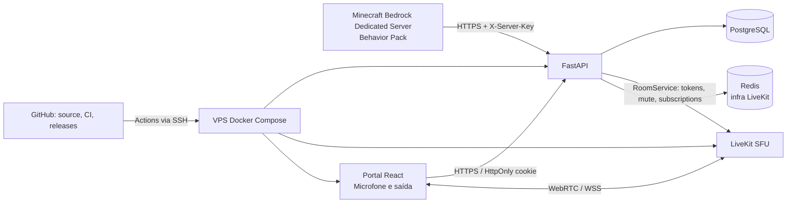

# Horizon Voice

Plataforma de voz por proximidade para **Minecraft Bedrock Dedicated Server (BDS)**. O projeto reúne o add-on Bedrock, API multi-tenant, portal web, áudio WebRTC/LiveKit, persistência, implantação Docker e automações de CI/CD.

> **Estado desta entrega: preview técnico integrado, ainda não certificado para produção.** O código contém o fluxo de conta/servidor, ativação, pareamento, envio de posição, presença, grupos exclusivos, token LiveKit, autorização de assinatura por proximidade/dimensão, mute/deafen, portal de áudio e implantação. Porém, ainda depende de validação real com o BDS exato, LiveKit publicado e vários navegadores. O add-on usa `@minecraft/server-net` em pré-lançamento. Não use em um servidor principal sem testar e fazer backup.

## Importante sobre GitHub e hospedagem

O GitHub é o repositório do código, documentação, releases, testes e automações. **O repositório e o GitHub Pages não executam uma API FastAPI persistente, PostgreSQL, Redis ou um SFU WebRTC.** GitHub Pages serve arquivos estáticos e não executa Python no servidor. Para manter API e voz ligados 24/7, esta configuração usa uma VPS com Docker Compose; GitHub Actions pode atualizar essa VPS após cada push. Veja [GitHub e deploy](docs/GITHUB.md).

## Recursos implementados

- Contas de proprietário e autenticação por token.
- Registro de servidor, subdomínio e ativação BDS por código único.
- Pareamento de navegador por código de seis dígitos, com expiração e uso único.
- Credencial independente por servidor e validação multi-tenant.
- Envio de posição em lotes, dimensão e estado online pelo add-on.
- Cálculo de vizinhança no servidor e isolamento entre dimensões.
- Token LiveKit temporário com publicação limitada a microfone e assinatura automática do cliente desabilitada.
- Assinaturas LiveKit seletivas autorizadas pela API segundo distância, dimensão, mute local/global, deafen e grupo ativo.
- Modo de grupo exclusivo: ao entrar em um grupo, o áudio por proximidade é suspenso.
- Controles de microfone, deafen, dispositivos, mute local e reconexão do navegador.
- Mute de servidor e moderação sincronizados com permissões/track do SFU.
- Webhook LiveKit com verificação de assinatura para atualizar presença.
- Grupos públicos e privados com senha hash Argon2.
- Portal do jogador e painel inicial de proprietário.
- Indicadores de voz no `nameTag` (`[LINK]`, `[FALANDO]`, `[MUDO]`).
- Docker Compose, Alembic, CI e pacote `.mcaddon`.

## Arquitetura



O áudio não passa pelo FastAPI. O LiveKit transporta o áudio; a API usa as posições e os estados autorizados do BDS para decidir quais faixas cada ouvinte pode assinar. A API foi configurada com um único worker porque o estado de sincronização e os limites de requisição ainda são locais ao processo.

## Estrutura

```text
addon/             Behavior Pack + Resource Pack BDS
backend/           FastAPI, modelos SQLAlchemy, migrations e testes
frontend/          React + TypeScript + LiveKit Web SDK
infra/              LiveKit, Nginx e HAProxy
scripts/             empacotamento, segredos e publicação GitHub
.github/workflows/  CI, deploy VPS e releases
certs/               certificado TLS local (não versionado)
docs/               instalação, compatibilidade, API, segurança e deploy
```

## Desenvolvimento local

Requisitos: Python 3.12+, Node.js 22+, npm e Git.

### API

```bash
cd backend
python -m venv .venv
# Windows: .venv\\Scripts\\activate
# Linux/macOS: source .venv/bin/activate
python -m pip install -e '.[test]'
uvicorn app.main:app --reload --host 127.0.0.1 --port 8000
```

A configuração de desenvolvimento usa SQLite e permite criar o schema automaticamente. LiveKit não estará disponível até que um servidor LiveKit real seja configurado; a API falha fechada e retorna `503` para emissão do token quando as chaves não existem.

### Portal

```bash
cd frontend
npm install
npm run dev
```

O Vite encaminha `/api` para `http://127.0.0.1:8000`. Abra `http://localhost:5173`.

### Testes da API

```bash
cd backend
python -m pytest -q
```

## Deploy completo

Leia [docs/DEPLOYMENT.md](docs/DEPLOYMENT.md). É necessário:

1. Uma VPS Linux com Docker Engine e Docker Compose.
2. DNS `A` para `voice-horizon.online` e `*.voice-horizon.online`.
3. Certificado TLS válido para o domínio raiz e wildcard, em `certs/fullchain.pem` e `certs/privkey.pem`.
4. Portas TCP/UDP do WebRTC e TURN abertas no firewall e no provedor.
5. `.env` com senhas reais geradas localmente.
6. `docker compose up -d --build`.

A distribuição recomendada é: GitHub armazena e testa; Actions faz deploy SSH; VPS executa API, PostgreSQL, Redis, Nginx e LiveKit.

## Instalação BDS

Leia [docs/INSTALLATION.md](docs/INSTALLATION.md) e [docs/COMPATIBILITY.md](docs/COMPATIBILITY.md). O pacote utiliza comandos namespaced:

- `/horizon:voz`
- `/horizon:voz mute`
- `/horizon:voz unmute`
- `/horizon:voz ajuda`
- `/horizon:cadastrarvoice <codigo>`

A Script API não registra os aliases literais `/voz` e `/cadastrarvoice` por este mecanismo. O `@minecraft/server-net` está em pré-lançamento e é exclusivo do BDS; esta é uma restrição externa do módulo, não uma funcionalidade que o projeto possa contornar.

## Artefatos

Gerar os pacotes:

```bash
python scripts/package_addon.py
```

Gerar um ZIP de fonte:

```bash
python scripts/package_source.py
```

O `.mcaddon` gerado é um pacote **preview**, não um certificado de compatibilidade com qualquer versão do Minecraft.

## Limitações conhecidas antes de produção

- `@minecraft/server-net` continua pré-lançamento; não há compatibilidade estável garantida entre versões BDS.
- `Player.id` é identidade de sessão da entidade, não XUID persistente; o jogador pode precisar parear novamente ao reconectar.
- O botão clicável de HUD não está implementado; o comando namespaced é o fallback funcional entregue.
- `speaking` é um estado de apresentação informado pelo navegador/LiveKit, não prova de identidade e não participa da autorização de áudio.
- Redis está instalado para LiveKit, mas a aplicação FastAPI ainda não usa Redis para rate limit, cache ou fanout distribuído. Não escale a API além de uma réplica.
- O painel do proprietário é uma primeira versão; fluxo de reset de senha, verificação de e-mail, transferir servidor e administração detalhada de grupos ainda não estão prontos.
- Testes reais BDS + múltiplos browsers + SFU, NAT/TURN e build Docker precisam ser executados em infraestrutura real antes da abertura pública.

Veja [docs/VALIDATION_REPORT.md](docs/VALIDATION_REPORT.md) para os resultados executados neste ambiente e [docs/SECURITY.md](docs/SECURITY.md) para riscos e requisitos de lançamento.

## Licença

MIT. Veja [LICENSE](LICENSE).
